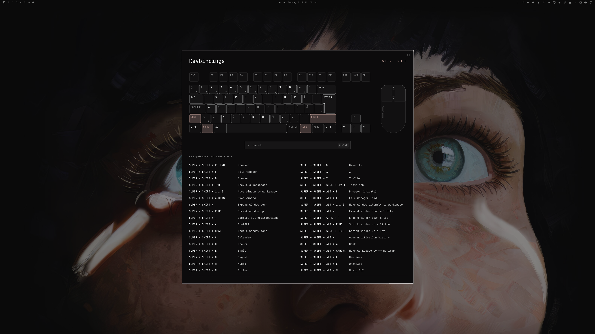

# Extended Keybindings Viewer

Omarchy's SUPER + K, extended: your keyboard and mouse on screen, with a
search box and every keybinding. Press a shortcut to see what it does, hold
modifiers to filter, point at a binding to see its keys. Nothing runs while
it is open.

Needs one manual step after installing to take over SUPER + K (see
[Set up](#set-up-super--k)).



## Use

- **Hold any key or combination** to see its keybindings: a full shortcut
  shows what it does, a single key or modifier (A, SUPER, SHIFT + A…) lists
  every binding that uses it. Its keys light up while you hold them.
- **Click or scroll** with modifiers to look up mouse bindings.
- **Ctrl+Tab** moves between keyboard, search and list; **Ctrl+F** searches;
  **Esc** closes.
- It opens as a card over your desktop; **Ctrl+Shift+F** or the button in its
  top right corner switches to fullscreen and back, and the choice is
  remembered.

The keys follow your keyboard layout (Å Ä Ö, й, α…) and the colours follow
your theme.

## Install

```bash
omarchy plugin add https://github.com/erikrjohansson/omarchy-extended-keybindings-viewer.git --enable
```

## Set up SUPER + K

Until you do this once, SUPER + K still opens Omarchy's own list. Open the
viewer:

```bash
omarchy-shell shell toggle io.github.erikrjohansson.extended-keybindings-viewer
```

Then click **Set up** in the overlay. It adds three marked lines to the end of
`~/.config/hypr/bindings.lua` so SUPER + K opens Extended Keybindings Viewer,
reloads Hyprland and reports any error. Nothing else in the file changes.

Prefer to do it yourself? Add this line to `~/.config/hypr/bindings.lua`:

```lua
dofile(os.getenv("HOME") .. "/.config/omarchy/plugins/io.github.erikrjohansson.extended-keybindings-viewer/bindings.lua")
```

## Update

```bash
omarchy plugin update io.github.erikrjohansson.extended-keybindings-viewer && omarchy restart hyprctl && omarchy restart shell
```

Omarchy shows the code changes first and asks before updating. The viewer
stays loaded between openings, so the shell only runs the new version after a
restart; reloading Hyprland picks up any change to the SUPER + K setup.

## Remove

```bash
~/.config/omarchy/plugins/io.github.erikrjohansson.extended-keybindings-viewer/extended-keybindings-viewer unsetup && omarchy plugin remove io.github.erikrjohansson.extended-keybindings-viewer
```

`unsetup` removes exactly the lines Set up added and reloads Hyprland, so the
plugin is only removed once Hyprland no longer loads it. If you added the line
yourself, delete it by hand first. SUPER + K then opens Omarchy's own list
again.

## How it stays safe

- While the viewer is open, Hyprland is in an empty submap, so pressing a
  shortcut only looks it up. Lookups stay off until that is confirmed.
- SUPER + K inside the overlay always restores your bindings, even if the
  shell stops responding. Last resort: `hyprctl dispatch 'hl.dsp.submap("reset")'`.
- Bindings marked universal (`submap_universal`) still run in every submap;
  the overlay warns when you have any.
- The list comes from Omarchy's own keybindings menu, so it matches
  `omarchy menu keybindings`. Like that menu, reading it loads your
  `hyprland.lua` with a stand-in `hl` and caches in `~/.cache/omarchy`.

## Requirements

Omarchy 4 (Quattro) with the Lua Hyprland config; tested on Omarchy 4.0.4 and
Hyprland 0.56.2. Uses `bash`, GNU `awk`, `jq`, `hyprctl`, `xkbcli` and `lua`,
all part of Omarchy. `python3` is optional (labels for non-Latin layouts).

## Notes

- The keyboard is drawn ISO or ANSI from the layout. To force one, create
  `~/.config/omarchy/extensions/extended-keybindings-viewer.json` containing
  `{ "shape": "ansi" }`. The fullscreen button saves `"fullscreen"` in the
  same file.
- Shortcuts are matched against Hyprland's first layout, from the main
  keyboard, read each time the overlay opens.
- Media keys and F13–F24 have no drawn key: they are listed and can be looked
  up, but light nothing.
- Two physical-key bindings (`code:NN`) with the same modifiers and
  description cannot be told apart.
